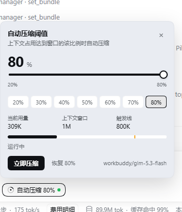

# dsh-compact-threshold

在 DeepSeek Harness（DSH）的输入框旁实时调节上下文自动压缩阈值（20%–80%）。不重启 DSH，不改 profile 配置；把阈值调到当前用量以下时，空闲状态下会立即触发一次压缩。



## 功能

- 输入框左下角的「自动压缩 XX%」胶囊，点击打开控制面板。
- 滑条范围固定为 **20%–80%**，支持 20/30/40/50/60/70/80 快捷档。
- 实时显示当前用量、上下文窗口、触发线和用量进度条。
- 调整后立即作用于当前运行中的压缩引擎；无需重启 DSH。
- 当新阈值低于当前用量时：
  - Agent 空闲：立即执行一次 `compactNow`（与 `/compact` 相同的底层路径）。
  - Agent 运行中：在下个 step 的自动压力检查中压缩。
- 「立即压缩」按钮可手动触发一次压缩。
- 中英文界面，跟随 DSH 语言设置。
- 不读取、不上传任何会话内容；用量统计使用 DSH 本地的 `tokenMeter`（`chars / 4` 启发式，增量计算，零网络请求、零 token）。

## 安装

### DSH Desktop（推荐）

在 **设置 → 插件 → 安装本地包 / 从压缩包安装** 中选择 GitHub Release 的 `.tgz`，或在插件管理器里安装本仓库：

```text
plugin_manager install_bundle target=<本仓库目录或 release tarball>
```

安装后在 **插件** 页启用 `dsh-compact-threshold`，无需重启（新 bundle 通过 HMR 生效）。

### DSH CLI

```bash
# 从 GitHub Release 的预构建 tarball 安装
dsh plugin --profile <profile> add \
  https://github.com/xlcg10086/dsh-compact-threshold/releases/download/v1.0.0/dsh-compact-threshold-1.0.0.tgz
```

也可以直接从 GitHub 安装源码（需要本地构建环境）：

```bash
dsh plugin --profile <profile> add github:xlcg10086/dsh-compact-threshold
```

## 使用

1. 在输入框左下角找到「自动压缩 80%」。
2. 点击胶囊打开面板。
3. 拖动滑条或点击快捷档调整阈值。
4. 查看「当前用量 / 上下文窗口 / 触发线」，确认触发线位置。
5. 需要立刻释放上下文时点击「立即压缩」。

面板中的「触发线」是插件实际会使用的阈值：它取 `min(窗口 × 比例, 窗口 - 输出预留 - headroom)`，因此输出预留较大的模型（例如 500K 窗口、184K 输出预留）会显示低于滑条比例的实际触发百分比。

## 工作原理

DSH 的 `BasicCompactionEngine` 在构造时会把 `compaction-basic` 配置解析成冻结对象，之后每个 step 读取 `this.config` 做压力判断。本插件不修改任何 profile 配置，而是：

1. 通过 `agentPresets.serviceFor(agent, 'compaction')` 取得该 Agent 所在 preset 隔离域中的真实压缩引擎实例；
2. 在 `agent/created`、`agent/pre-step` 和 `agent/status` 事件中，把当前滑条比例写入引擎实例的 `config.thresholdRatio`；
3. 下一次 `compactIfNeeded()` 因此使用新阈值——这是不需要重启 DSH 的关键；
4. 滑条降到低于当前用量时，根据 Agent 状态选择 `compactNow()` 或下一个 step 的 `compactIfNeeded()`。

阈值持久化在 `$DSH_HOME/compact-control.json`，重启 DSH 后保留。

### 为什么是 20%–80%

- **上限 80%**：DSH 内置 `compaction-basic` 的 `thresholdRatio` 默认与上限均为 0.8；超过 80% 会拖累模型性能，也会与内置配置冲突。
- **下限 20%**：`retainRatio` 为 0.16，阈值必须明显大于保留比例，否则会出现「刚压缩完立刻又触发」的抖动。20% 留出了足够的安全边界。

## 兼容性

- DSH `>= 0.2.1-rc.2`
- Web Client（`dsh.client.platform: "web"`）
- 已验证：DSH Desktop 2.0.18 / DSH 0.2.1-rc.2，Windows

## 隐私

插件不包含任何网络请求、遥测或外部服务调用。它只读写：

- 当前会话的本地 `tokenMeter` 测量值；
- 当前压缩引擎的运行时配置；
- `$DSH_HOME/compact-control.json` 中的阈值。

## 开发

```bash
# 语法检查
node --check index.js
node --check client.js

# 本地安装（DSH Desktop 插件管理器）
plugin_manager install_bundle target=<本仓库绝对路径>
```

插件结构：

- `index.js` — Host：阈值状态、HTTP 路由、压缩引擎注入、立即压缩
- `client.js` — Client：`conversation.input.left` 槽位中的胶囊与面板
- `cordis.patch.yml` — bundle 补丁
- `locale/*.json` — DSH 插件列表显示元数据
- `icon.svg`、`assets/icon-256.png` — 插件图标

## English

Live auto-compaction threshold control (20%–80%) for the DeepSeek Harness composer. Adjust the threshold without restarting DSH; lowering it below current usage triggers compaction immediately when the agent is idle. See the Chinese sections above for the full design notes, or install the release tarball:

```bash
dsh plugin --profile <profile> add \
  https://github.com/xlcg10086/dsh-compact-threshold/releases/download/v1.0.0/dsh-compact-threshold-1.0.0.tgz
```

## License

MIT © 2026 xlcg10086
